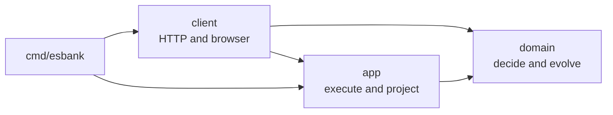
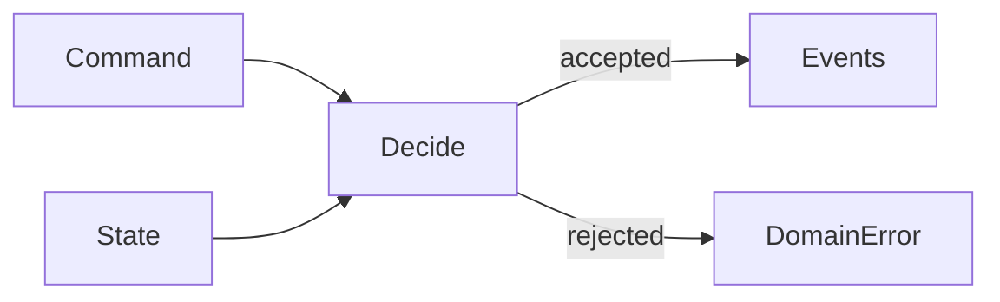
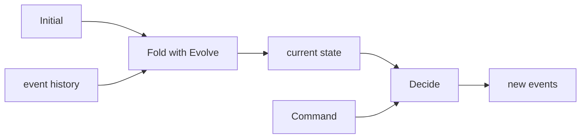
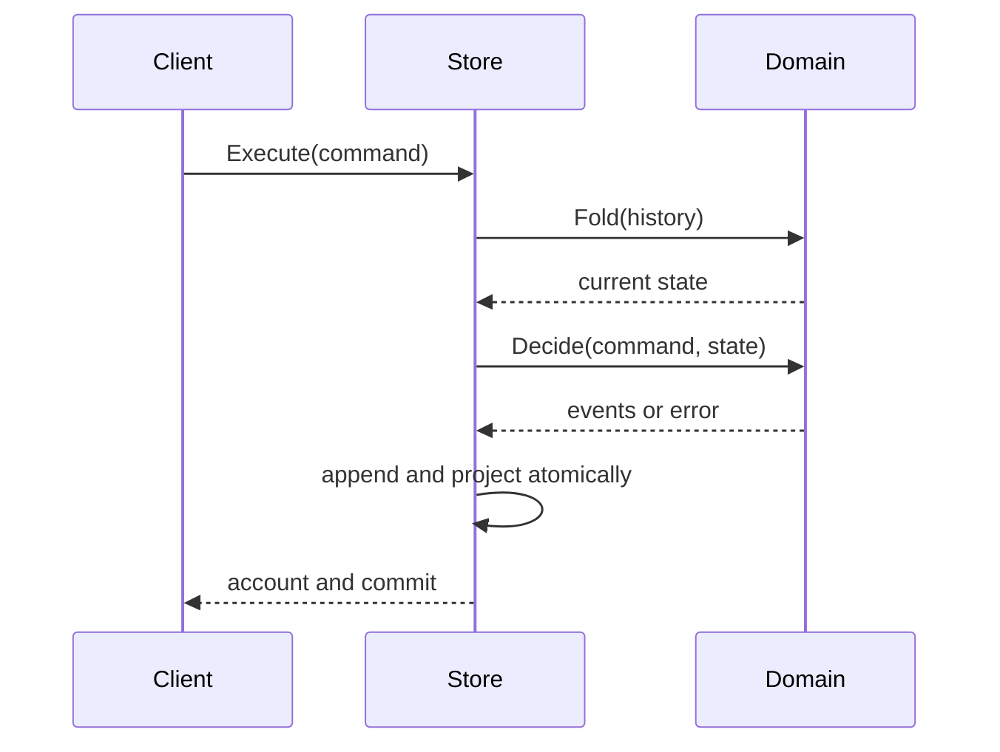

# Go event-sourced bank account

A Go port of [akhansari/EsBankAccount][upstream], the F# bank-account kata and
functional event-sourcing proof of concept.

The port keeps the original decider rules and user-visible workflow while
replacing Blazor, Elmish, Equinox, and the fake database with a small Go server
and a dependency-free browser UI.

## Run

The project requires Go 1.27 or newer through [`go-functionalish`][library].
Use the latest patched stable Go release:

```sh
go run ./cmd/esbank
```

Open <http://localhost:8080>. Use `-addr` to choose another listen address.

All event streams and projections are volatile and reset when the process
stops. The default address is loopback-only. Binding another interface shares
one unauthenticated ledger with every client that can reach the server, so do
not expose this kata to an untrusted network.

## Domain rules

- Deposits and withdrawals emit one event.
- Withdrawals may overdraw unless a threshold is supplied to the domain decider.
- A threshold is inclusive: reaching it is allowed, crossing it is rejected.
- Closing a positive account emits a full-balance withdrawal followed by `Closed`.
- A negative account cannot close.
- Every command against a closed account is rejected.
- State is always reconstructed by folding the event history.

The HTTP boundary accepts only positive amounts with at most two decimal
places. The pure domain deliberately preserves the original kata behavior for
zero and negative amounts.

## Architecture



The bank feature is split by responsibility:

- `domain/account.go` defines commands, events, state, and errors.
- `domain/decider.go` contains the pure decision and evolution functions.
- `domain/money.go` handles exact decimal amounts and checked arithmetic.
- `app/store.go` coordinates streams and the read model atomically.
- `client/` contains the JSON API and embedded browser application.

The application uses `go-functionalish` where the functional model benefits
from it:

- `result.Result` for accepted or rejected decisions
- `option.Option` for optional withdrawal thresholds
- `seq.Seq` to fold event history into aggregate state
- `slice.Slice` for mapping, folding, and state-threaded `MapFold`
- `kv.Seq2` to transform map-backed projections

No framework, reflection, database, frontend toolchain, or runtime CDN is required.

## Decider pattern

The domain follows Jeremie Chassaing's
[Functional Event Sourcing Decider][decider-article] pattern. A decision is a
pure function of a command and the current state. It returns events on success
or a domain error on rejection; it does not persist data or perform I/O.



`Evolve` is the other pure function. Folding the event history from `Initial`
reconstructs the current state before each decision.



The application layer connects those pure functions to the volatile event
store and projection:



## Test

```sh
go test -race ./...
go vet ./...
```

The tests port the original event and state scenarios, then add projection,
command API, input-boundary, and error-path coverage.

## API

- `GET /api/accounts`
- `GET /api/account?id=<account>`
- `GET /api/commits`
- `POST /api/commands`

Command body:

```json
{
  "accountId": "checking",
  "type": "deposit",
  "amount": "25.00"
}
```

`type` is `deposit`, `withdraw`, or `close`. Close does not require an amount.

## Attribution

The original project and kata were created by Amin Khansari and released under
the MIT License. This port retains that copyright notice.

[library]: https://github.com/natalie-o-perret/go-functionalish
[upstream]: https://github.com/akhansari/EsBankAccount
[decider-article]: https://thinkbeforecoding.com/post/2021/12/17/functional-event-sourcing-decider
